# Personalregister - dokumentation

## Relevanta filer

Bilder: root/Images
Markdown: root/documentation.md
SQL: root/labb2.sql
Javaklasser: root/src/main/java/se.iths.alfred.personalregister

## Entiteter och attribut

| employee (Anställda) | Attribut                                               |
|----------------------|--------------------------------------------------------|
| employee_id          | INT, AUTO_INCREMENT, PRIMARY KEY                       |
| first_name           | VARCHAR (30), NOT NULL                                 |
| last_name            | VARCHAR (30), NOT NULL                                 |
| email                | VARCHAR (100), UNIQUE, NOT NULL                        |
| start_date           | DATE, NOT NULL                                         |
| department_id        | INT, NOT NULL, FOREIGN KEY → department(department_id) |

| department (Avdelningar) | Attribut                         |
|--------------------------|----------------------------------|
| department_id            | INT, AUTO_INCREMENT, PRIMARY KEY |
| department_name          | VARCHAR (30), NOT NULL           |
| city                     | VARCHAR (30), NOT NULL           |

| keycard (Passerkort) | Attribut                                                   |
|----------------------|------------------------------------------------------------|
| keycard_id           | INT, AUTO_INCREMENT, PRIMARY KEY                           |
| card_number          | INT, UNIQUE, NOT NULL                                      |
| issue_date           | DATE, NOT NULL                                             |
| expiry_date          | DATE, NOT NULL                                             |
| employee_id          | INT, UNIQUE, NOT NULL, FOREIGN KEY → employee(employee_id) |

| skill (Kompetenser) | Attribut                         |
|---------------------|----------------------------------|
| skill_id            | INT, AUTO_INCREMENT, PRIMARY KEY |
| skill_name          | VARCHAR(30), UNIQUE, NOT NULL    |
| skill_description   | VARCHAR(200), NOT NULL           |

| employee_skill (kopplingstabell) | Attribut                                 |
|----------------------------------|------------------------------------------|
| employee_id                      | INT, NOT NULL, PRIMARY KEY, FOREIGN KEY  |
| skill_id                         | INT, NOT NULL, PRIMARY KEY,  FOREIGN KEY |

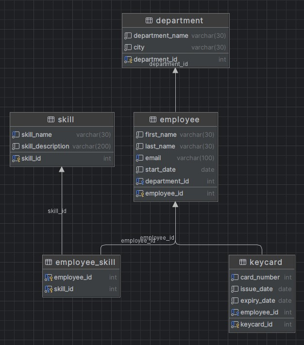

## Relationer

**Avdelningar ⟷ Anställda**  
Kardinalitet: 1:N. En avdelning kan ha många anställda, men en anställd tillhör endast en avdelning.  
Koppling: Obligatorisk. Alla anställda jobbar på en avdelning var, och därför behöver *employee* referens till
*department*.

**Anställda ⟷ Passerkort**  
Kardinalitet: 1:1  
Koppling: Valfri. Inte alla anställda har passerkort. De som har passerkort kan endast ha ett. Varje passerkort
tillhör endast en person.

**Anställda ⟷ Kompetenser**  
Kardinalitet: N:N
Koppling: Valfri. En anställd kan ha flera kompetenser eller inga alls. Kompetenser kan också tilldelas till
en eller flera anställda.

## Motivering av designval

### Primära och främmande nycklar

* Varje PK är en egen kolumn i form av ett automatiskt uppräknande heltal för enkelhets skull, och för att systemet inte
  ska vara beroende av en annan kolumn, exempelvis *email* som inte omöjligt skulle kunna ändras i framtiden.
* FK *department_id* ligger i *employee* eftersom många anställda ska kunna hänvisa till samma avdelning (1:N-relation).
  FK *employee_id* ligger i *keycard* för att undvika tomma *`<null>`*-värden på anställda som inte har något
  passerkort.
* Kopplingstabellen *employee_skill* används för att hantera N:N-relationen mellan *employee* och *skill*. Eftersom
  *skill*-tabellen enskilt saknar beroenden till andra tabeller kan kompetenser existera innan den tilldelas till
  anställda.

### Regler och begränsningar

* För att säkerställa att varje anställd tillhör en avdelning är *department_id* NOT NULL.
* I *keycard* är *employee_id* UNIQUE så att ingen anställd kan tilldelas mer än ett passerkort.
* *Employee_skill*-tabellen använder två primärnycklar som en sammansatt nyckel. På så vis kan kompetenser inte
  tilldelas till samma anställd flera gånger.

### Datatyper

* Attributen använder INT, VARCHAR, och DATE som kan konverteras till Integer, String, och LocalDate i Java.
* *Employee (email)* och *skill (description)* har fått ett större teckenutrymme för att tillåta längre inmatningar.

### Java-applikation

Javaklasserna *Employee*, *Department*, *Keycard*, och *Skill* representerar varje huvudtabell i databasen. Varje kolumn
har blivit privata fält med motsvarande datatyper (t.ex. INT → Integer, VARCHAR → String) och hämtas via get-metoder.

Relationerna 1:N och 1:1 representeras av direkta objektreferenser (t.ex. *Department department*) i *Employee*-klassen.
*employee_skill*-tabellen behöver ingen egen klass. Den N:N-relationen hanteras istället av listan *skillList* i
*Employee*. På så sätt kan kompetenser skapas som enskilda, återanvändbara objekt, och sparas i listan på varje
*Employee*-objekt. Detta medför att kopplingen bara behövs från ett håll: *Employee* → *Skill*

Programmet startas genom att köra *Main*-klassen. Då skapas all testdata och skrivs ut till konsolen
från varje Employee-objekts *toString*-metod. Den oanvända kompetensen visas också efter alla anställda.

## Applikationens utskrifter

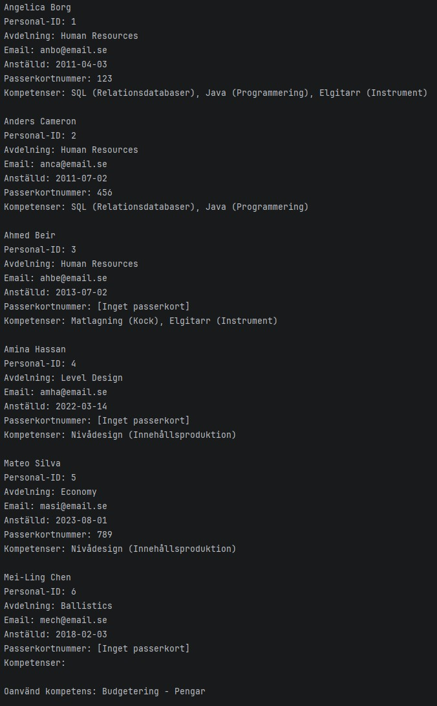

## JOIN-frågor G1 och G2

Med INNER JOIN visas alla anställda som har en kopplad avdelning. Eftersom ingen anställd är registrerad till *Accounts*
visas den inte.  
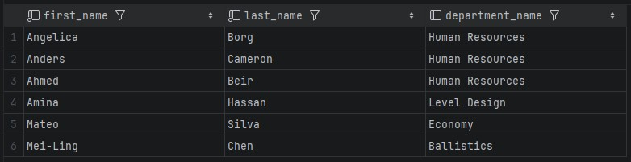

Med LEFT JOIN visas alla rader från tabellen efter FROM. Därför listas alla avdelningar, även *Accounts* som saknar
anställda.  
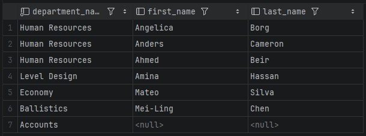

## JOIN-frågor för VG

### VG1: Anställda med avdelning och passerkort

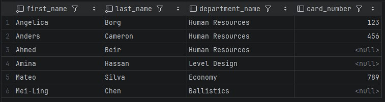

### VG2: Avdelningar med anställda och passerkort

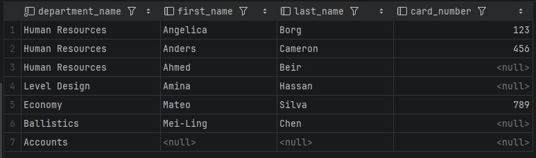

### VG3:

**En anställds samlade uppgifter**  
Med en join upprepas den anställdes uppgifter en gång för varje matchande rad i *skill*-tabellen.
Eftersom den anställde har tre kompetenser visas den alltså tre gånger.
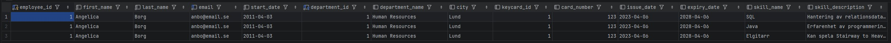

**En anställd utan passerkort**
Med en LEFT JOIN visas alla rader i listan direkt efter FROM, i det här fallet *employee*.
LEFT JOIN fyller även ut passerkortets kolumner med *`<null>`* om en matchning saknas.
WHERE begränsar i sin tur raderna till en enda med dess unika matchande *employee_id*.
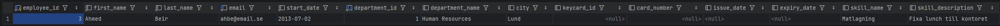

**En anställd utan kompetenser**
Precis som i den föregående tabellen hämtar vi här alla rader i *employee* och filtrerar ut
den enda vars *employee_id* matchar, och med LEFT JOIN får vi *`<null>`* i kompetenskolumnerna.
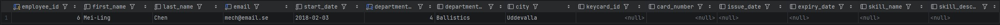

### VG4: Jämför INNER JOIN och LEFT JOIN

**INNER JOIN**  
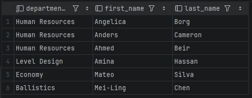

**LEFT JOIN**  
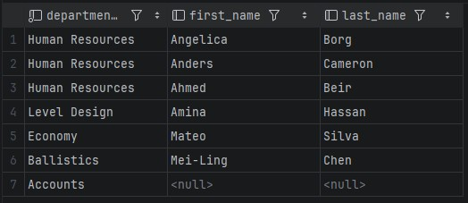

Avdelning 5, *Accounts*, försvinner med en INNER JOIN. Med en LEFT JOIN finns den kvar eftersom alla
rader hämtas från tabellen till höger om FROM som vi utgår från. Eftersom *Accounts* saknar anställda
skrivs *`<null>`* ut i både *first_name* och *last_name*.